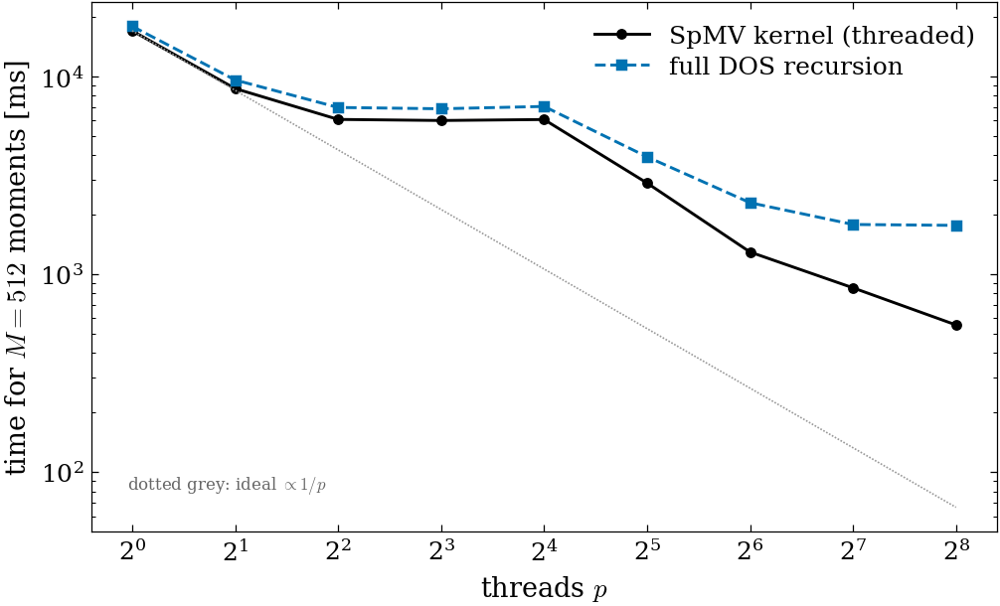
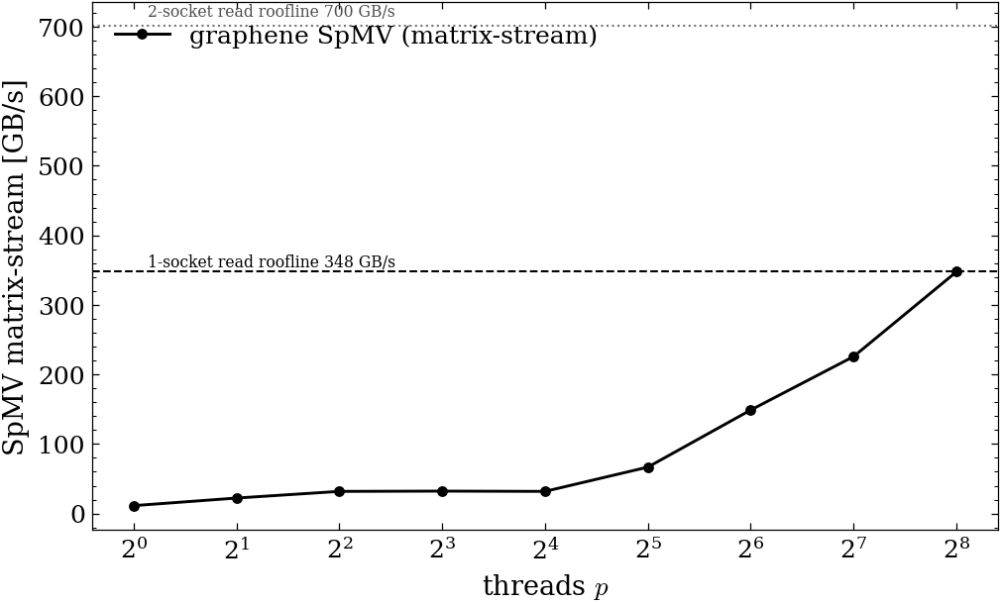

# Performance & scaling — threaded SpMV (graphene, dual EPYC 9754)

Measured on a dual **AMD EPYC 9754** (Bergamo): 2 sockets × 128 cores = 256 cores, SMT off,
2 NUMA nodes, 512 MiB aggregate L3 (32 × 16 MiB CCX), 1.5 TiB RAM, gcc 11.5
`-O3 -march=native` (AVX-512). Reproduce current scaling benchmarks with the scripts under
`bench/` (`bench/bench_realspace_vs_bloch.py`, `bench/bench_2d_scaling.py`,
`bench/bench_disorder_scaling.py`).

## The kernel

The KPM moment recursion's `O(nnz)` hot loop is the leaf sparse matrix–vector / matrix–matrix
product `lsquant::algebra::SparseMatrix::Apply` and `ApplyBatch` (`y = a·O·x + b·y`).
It uses a row-parallel OpenMP fused kernel alongside the batched SpMM block kernel.
Cross-vector moment dot products and AXPY reductions are deterministic in golden mode so that
thread count never changes floating-point summation order when reproducing golden references.

## System

Graphene (honeycomb, 2-atom basis), nearest-neighbour `t1 = −2.7 eV` plus a complex
Haldane-type next-nearest hopping `t2 = 0.10 eV, φ = π/2` → a complex Hermitian operator,
~9 nonzeros/row. Thread sweep at `N = 2,000,000` sites (18 M nonzeros), DOS, `M = 512`
Chebyshev moments.

## Result 1 — thread scaling (fixed N = 2 M)

| threads | SpMV ms/call | SpMV GB/s | % socket roofline | full recursion (ms) |
|---:|---:|---:|---:|---:|
| 1   | 33.17 | 11.3  | —     | 17930 |
| 2   | 16.92 | 22.2  | —     | 9595 |
| 4   | 11.82 | 31.8  | —     | 6969 |
| 8   | 11.67 | 32.2  | 9%    | 6864 |
| 16  | 11.81 | 31.8  | 9%    | 7053 |
| 32  | 5.64  | 66.7  | 19%   | 3924 |
| 64  | 2.53  | 148.8 | 43%   | 2301 |
| 128 | 1.67  | **225.7** | **65%** | 1786 |
| 256¹| 1.08  | **347.6** | 50%²  | 1767 |

¹ 256 threads spans both sockets (`numactl --interleave=all`).
² of the 700 GB/s 2-socket read roofline (65% of the per-socket roofline 348 is the
clean single-socket number at 128).

- **SpMV speedup: 19.9× at 128 threads (one socket), 30.7× at 256** (33.17 → 1.08 ms).
- **Full DOS recursion: 17.9 s → 1.77 s (10.1×)**.

## Result 2 — size scaling (fixed 128 threads, M = 256)

`N` swept 12.8 k → 2 M. The SpMV cost is **linear in N** in the DRAM-bound regime (large N).
Mid-size points (N ≈ 0.5–0.8 M) exceed the DRAM roofline because the ~150–250 MB matrix is
partly L3-cache-served. Beyond L3 the curve is linear and DRAM-bound.

## NUMA policy

The SpMV/SpMM kernels use `#pragma omp parallel for schedule(static)`, so each thread owns a
fixed, contiguous row range across every Chebyshev iteration. For large dual-socket runs with
kernel NUMA balancing off, launch with `numactl --interleave=all` or pin to one socket with
`numactl --cpunodebind=0 --membind=0`.
