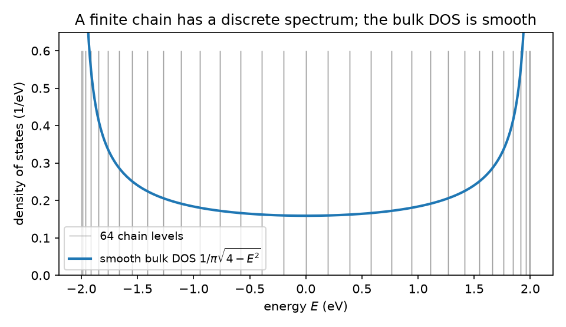
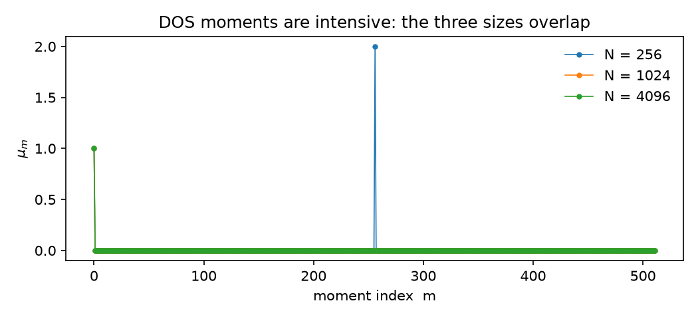
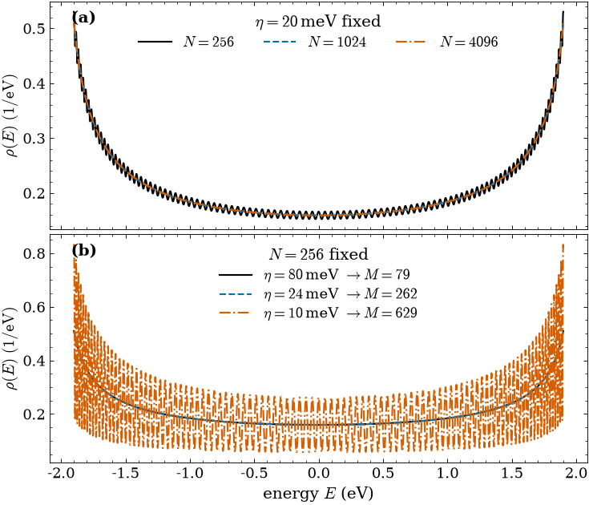

# Tutorial 1: The density of states of a 1D chain

A single quantum particle hopping along a chain of atoms is about the simplest
thing in solid-state physics, and it already hides a puzzle. A chain of $N$ atoms
has exactly $N$ energy levels, a finite list of sharp numbers. Yet we routinely
draw its density of states as a smooth curve, as if energy came in a continuum.
Where does the smooth curve come from, and what did we throw away to get it?

That gap between a finite spectrum and a smooth density is the finite-size
problem, and it sits underneath every large-scale calculation LSQUANT does. Here we
watch it appear on the 1D chain and watch the kernel polynomial method (KPM) tame
it with a single dial: the number of Chebyshev moments we keep. The lesson here is
the one that returns in every later tutorial, that the moment count is the
resolution dial and the finiteness of the sample hides in a single revival.

## The physics

The chain has $N$ sites, one orbital each, periodic boundaries, and a single
hopping amplitude $t = -1\ \mathrm{eV}$:

$$ H = t\sum_i \big( |i\rangle\langle i+1| + |i+1\rangle\langle i| \big), \qquad i+1 \ \mathrm{mod}\ N. $$

Its eigenvalues are known in closed form, $E_k = 2t\cos(2\pi k/N)$, so the
spectrum fills the band $[-2, 2]\ \mathrm{eV}$. In the infinite-chain limit those
$N$ points crowd into a smooth density of states,

$$ \rho(E) = \frac{1}{\pi\sqrt{4 - E^2}}, $$

with van Hove divergences at the band edges $E = \pm 2\ \mathrm{eV}$, where the
levels bunch most tightly.

KPM reaches that curve without diagonalizing $H$. It expands the density of states
in Chebyshev polynomials of the rescaled Hamiltonian $\tilde H = (H - b)/a$, where
$(a, b)$ map the band onto $[-1, 1]$, and the expansion coefficients are the
moments of the word `Tr[delta(E-H)]`:

$$ \mu_m = \frac{1}{N}\,\mathrm{Tr}\,T_m(\tilde H). $$

For this chain the trace can be done by hand, and the answer drives everything
that follows: using $T_m(\cos\theta) = \cos m\theta$ and the discrete
orthogonality of the $N$ levels,

$$ \mu_m = \frac{1}{N}\sum_{k=0}^{N-1}\cos\!\Big(\frac{2\pi m k}{N}\Big) = \delta_{m,0} + \delta_{m,N} + \delta_{m,2N} + \cdots $$

The bulk density of states is exactly the Chebyshev weight, so its expansion
terminates at the very first term: $\mu_0 = 1$ and nothing else, all the way up to
$m = N$. The finiteness of the chain changes no low-order moment. It hides in one
place only, a revival where $\mu_m$ spikes again at $m = N$ and every multiple
after, the spectrum reminding us it is discrete.



## Step 1: build the chains and compute the moments

The run file [`run_dos.json`](run_dos.json) calls [`make_chain.py`](make_chain.py)
for $N = 256, 1024, 4096$, evaluates $M = 512$ exact-trace Chebyshev moments of
`Tr[delta(E-H)]`, and reconstructs the density of states across broadenings:

```bash
python3 -m lsquant run examples/01_dos_1d_chain/run_dos.json --out /tmp/tut01
```

You can also build a single chain directly with `python3 make_chain.py 256`, which
writes `operators/chain1d_N256.HAM.CSR` and its `.desc` sidecar.

## Step 2: the moments are intensive and resolution follows the moment count

Generate all three tutorial figures from the run output directory:

```bash
python3 examples/01_dos_1d_chain/plot.py /tmp/tut01
```



The three moment curves in `fig_moments.png` are indistinguishable below their
revivals: every one sits at $\mu_m = \delta_{m,0}$. They part company only at
$m = N$: the $N = 256$ moments spike back up at $m = 256$ (to $2$, carrying the
KPM weight $2 - \delta_{m,0}$), while $N = 1024$ and $N = 4096$ revive beyond the
$M = 512$ window.

To turn moments back into a curve LSQUANT contracts

$$ \rho(E) = \sum_{m=0}^{M-1} g_m\,\mu_m\,\frac{(2 - \delta_{m,0})\,T_m(\tilde E)}{\pi\sqrt{a^2 - (E-b)^2}}, $$

where $g_m$ are the Jackson kernel coefficients for target broadening $\eta$,
keeping $M_{\mathrm{eff}} = \lceil \pi W_{1/2} / \eta \rceil$ moments. To
reconstruct at a custom broadening on the fly:

```bash
python3 -m lsquant reconstruct /tmp/tut01/SpectralOp1chain1d_N256KPM_M512_stateexact_chain1d_N256.chebmom1D --formula dos --broadening-meV 120
```



In `fig_dos.png`, panel (a) fixes $\eta = 20\ \mathrm{meV}$ ($M_{\mathrm{eff}}\approx 315$):
$N = 256$ has $M_{\mathrm{eff}} > N$ and resolves its discrete levels, whereas
$N = 1024$ and $N = 4096$ stay on the smooth bulk curve. Panel (b) fixes $N = 256$
and sweeps $\eta = 80, 24, 10\ \mathrm{meV}$ across the $M_{\mathrm{eff}} = N$
revival threshold.

## Output files and figures

| File | Description |
|---|---|
| `SpectralOp1chain1d_N{256,1024,4096}*.chebmom1D` | Rank-1 Chebyshev moments ($M = 512$, exact trace) |
| `meanSpectralOp1chain1d_N256*JACKSON.dat` | Extensive DOS $N\rho(E)$ at $\eta = 120\ \mathrm{meV}$ |
| `eta{20,80,24,10}/meanmoments_chain1d_N*_M512JACKSON.dat` | Reconstructed DOS curves across system sizes and broadenings |
| `run.resolved.json` | Resolved run configuration and file manifest |
| `fig_levels.png` | Discrete chain eigenvalues ($N = 64$) under the bulk continuum DOS |
| `fig_moments.png` | Chebyshev moments $\mu_m$ for $N = 256, 1024, 4096$ showing the $m = N$ revival |
| `fig_dos.png` | Reconstructed DOS vs. system size $N$ (panel a) and vs. broadening $\eta$ (panel b) |

## What to take away

- The bulk density of states of this chain is the Chebyshev weight itself, so its
  moments are $\mu_m = \delta_{m,0}$ and a single moment reconstructs it exactly.
- The moments are intensive: every chain length gives the same low-order moments,
  which is what lets one expansion scale to enormous systems.
- A finite chain enters only through the aliasing revival at $m = N$. Below it you
  see the smooth bulk; above it you resolve the discrete levels.
- The KPM broadening is $\eta = \pi W_{1/2} / M$, so the moment count is the
  resolution knob, no more and no less.

## References

- A. Weiße, G. Wellein, A. Alvermann, and H. Fehske, *The kernel polynomial method*,
  Rev. Mod. Phys. **78**, 275 (2006).
- Z. Fan, J. H. García, A. W. Cummings et al., *Linear scaling quantum transport
  methodologies*, Phys. Rep. **893**, 1–123 (2021) ([arXiv:1811.07387](https://arxiv.org/abs/1811.07387)).
