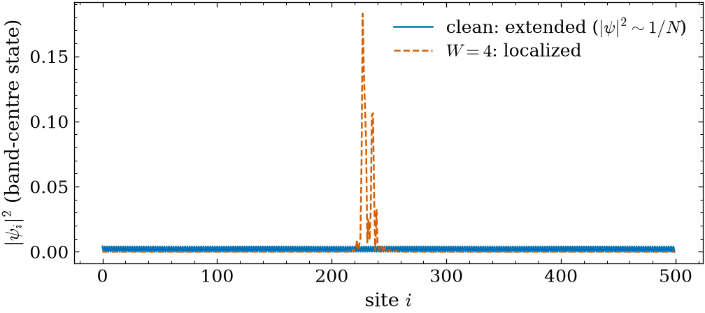
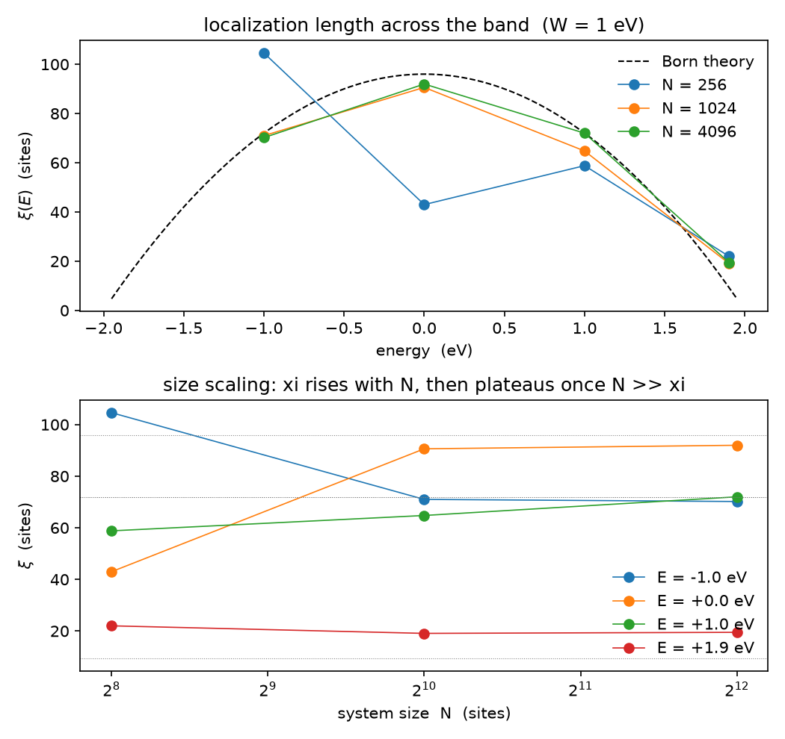

# Tutorial 2: How a 1D wire localizes under disorder

Take the clean chain of Tutorial 1, where a wavepacket spreads forever, and
sprinkle a little randomness on the site energies. Something drastic happens that
has no analogue in three dimensions: the wavepacket stops. Every eigenstate, at
every energy, however weak the disorder, becomes exponentially trapped over some
length $\xi$, and the wire turns into an insulator. The puzzle is not whether
this happens but how far the particle gets first, and how that distance changes
as we move across the band.

We measure that distance without diagonalizing anything, by watching how far a
wavepacket spreads before disorder pins it. The lesson here is that the
localization length is a property we can read straight off the spreading, that it
follows the band the way weak-disorder theory predicts, and that a finite sample
only reveals it once the sample itself is a few $\xi$ long.

## The physics

The Anderson chain keeps the nearest-neighbour hopping of Tutorial 1 and adds an
independent random energy on each site,

$$ H = t\sum_i \big( |i\rangle\langle i+1| + |i+1\rangle\langle i| \big) + \sum_i \epsilon_i\,|i\rangle\langle i|, \qquad \epsilon_i \ \text{uniform in}\ [-W/2,\,W/2], \quad t = -1\ \mathrm{eV}. $$

For any nonzero $W$ every eigenstate is exponentially localized, so the chain is
an insulator at all energies: the one-parameter scaling flow of localization runs
to the localized fixed point for all conductances in one dimension. The
localization length is the inverse Lyapunov exponent, $\xi(E) = 1/\gamma(E)$, and
in the weak-disorder (Born) regime, away from the centre and the edges, box
disorder gives

$$ \xi(E) \approx \frac{24\,(4 - E^2)}{W^2}. $$

Two places in the band break this form. At the centre the Kappus–Wegner anomaly
lifts the value to $\xi(0) \approx 105/W^2$, above the Born estimate $96/W^2$.
Near the edges $E \to \pm 2$ the Lyapunov exponent follows a separate
$\gamma \sim W^{2/3}$ law, so the Born curve gives way there.

The single idea that makes this measurable: a localized state cannot let a
wavepacket spread past its own size. The clean chain spreads ballistically,
$\mathrm{MSD}(E,t)\sim t^2$; disorder bends that growth over and parks it on a
plateau whose height is set by $\xi(E)$, so $\sqrt{\mathrm{MSD}_{\mathrm{plateau}}}$
tracks the localization length. LSQUANT evaluates the mean-square displacement word
`Tr[[X, U(t)]^+ delta(E-H) [X, U(t)]]` using the Bessel–Chebyshev expansion of
$U(t)$ and the Chebyshev expansion of $\delta(E-H)$.



## Step 1: run the localization ensemble

[`run_localization.json`](run_localization.json) invokes
[`make_disordered_chain.py`](make_disordered_chain.py) across $N = 256, 1024, 4096$
and $16$ disorder realisations at $W = 1.0\ \mathrm{eV}$, evaluates $M = 256$
Chebyshev moments of `Tr[[X, U(t)]^+ delta(E-H) [X, U(t)]]` over $128$ time steps
up to $t_{\max} = 600\ \mathrm{fs}$, and reconstructs $\mathrm{MSD}(E, t)$ at
$E = 0, \pm 1, 1.9\ \mathrm{eV}$ ($\eta = 10\ \mathrm{meV}$):

```bash
python3 -m lsquant run examples/02_localization_1d_chain/run_localization.json --out /tmp/tut02
```

To build a single disordered chain on disk directly:

```bash
python3 examples/02_localization_1d_chain/make_disordered_chain.py 512 1.0 1
```

## Step 2: the localization length follows the band

Generate the tutorial figures from the run output directory:

```bash
python3 examples/02_localization_1d_chain/plot.py /tmp/tut02
```



In `fig_localization.png`, panel (a) compares $\xi(E)$ extracted from
$\sqrt{\mathrm{MSD}_{\mathrm{plateau}}}$ against the Born curve
$\xi(E) \approx 24(4-E^2)/W^2$: for $N = 4096$ the interior points $E = 0, \pm 1\ \mathrm{eV}$
land on the Born curve, while $E = 1.9\ \mathrm{eV}$ departs near the band edge
where the $W^{2/3}$ law takes over. Panel (b) shows finite-size scaling with $N$:
each curve rises while $N \lesssim \xi(E)$ and saturates once the chain exceeds a
few localization lengths.

## Output files and figures

| File | Description |
|---|---|
| `mean*chain1d_dis_N512_W1*EF0.000000*JACKSON.dat` | Single-realisation $\mathrm{MSD}(E=0, t)$ curve for $N = 512$ |
| `r01..r16/mean*chain1d_dis_N{256,1024,4096}_W1*EF*.dat` | Per-realisation $\mathrm{MSD}(E, t)$ curves across sizes and Fermi energies |
| `run.resolved.json` | Resolved run configuration and file manifest |
| `fig_anderson.png` | Band-centre eigenstate density $|\psi_i|^2$ for clean ($W=0$) vs. disordered ($W=4$) chain |
| `fig_localization.png` | Extracted localization length $\xi(E)$ vs. Born theory (panel a) and vs. chain size $N$ (panel b) |

## What to take away

- Disorder localizes every state in one dimension, so the chain is an insulator
  across the whole band, no matter how weak the disorder.
- The localization length follows $\xi(E)\approx 24(4-E^2)/W^2$ in the band
  interior and changes law near the edges.
- The mean-square-displacement plateau is a direct localization-length proxy: its
  $1/W^2$ and $(4-E^2)$ trends read straight off the spreading.
- A finite sample recovers the theory only once its length passes a few $\xi$.

## References

- Z. Fan, J. H. García, A. W. Cummings et al., *Linear scaling quantum transport
  methodologies*, Phys. Rep. **893**, 1–123 (2021) ([arXiv:1811.07387](https://arxiv.org/abs/1811.07387)).
- B. Derrida and E. Gardner, *Lyapunov exponent of the one dimensional Anderson
  model: weak disorder expansions*, J. Phys. (Paris) **45**, 1283 (1984).
