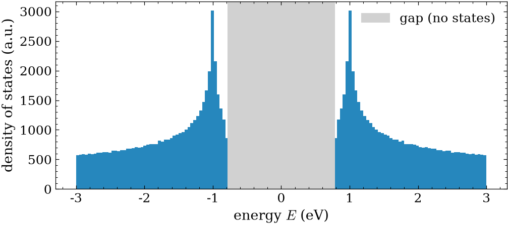
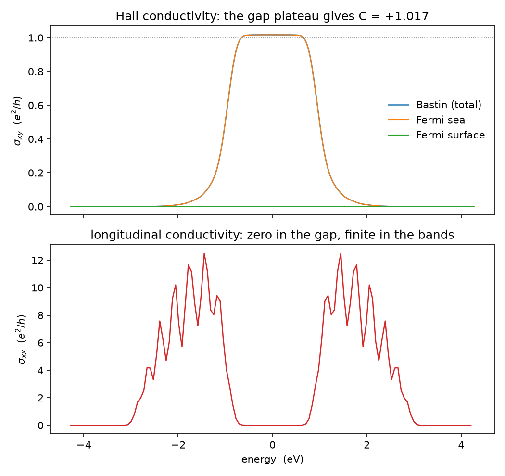
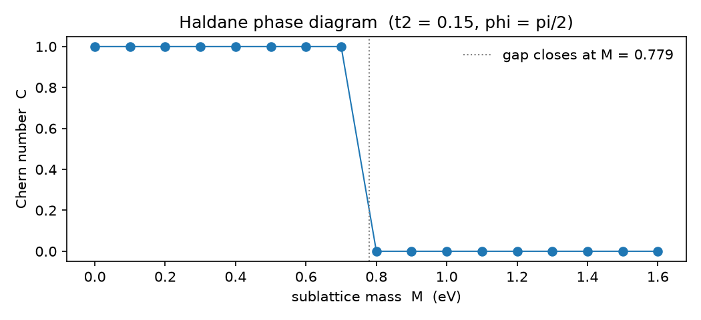

# Tutorial 3: A quantized Hall current without a magnetic field

Hall conductance was supposed to need a magnetic field: ramp the field, and the
transverse conductivity climbs a staircase of plateaus quantized in units of
$e^2/h$. Haldane's surprise was that the field is optional. Put complex
next-nearest-neighbour hoppings on a honeycomb lattice, arrange them so the net
flux through each cell is zero, and the system still carries a Hall current locked
to an integer times $e^2/h$, with no Landau levels anywhere in sight.

If the quantization does not come from a field, where does it come from, and why
does it survive in a gap where there are no states at the Fermi level to carry
current? We compute the Hall and longitudinal conductivities and split the Hall
response into its pieces to answer both. The lesson here is that the plateau is a
property of the entire filled Fermi sea, fixed by a topological integer of the
bands, while the longitudinal conductivity, which needs a Fermi surface, vanishes
in the same gap.

## The physics

The Haldane model lives on a honeycomb lattice with a real nearest-neighbour
hopping $t_1$, a complex next-nearest-neighbour hopping $t_2 e^{i\phi}$ that
carries a staggered flux, and an optional sublattice mass $M$:

$$ H = t_1\!\sum_{\langle ij\rangle} c_i^\dagger c_j \;+\; t_2\!\sum_{\langle\langle ij\rangle\rangle} e^{i\nu_{ij}\phi}\,c_i^\dagger c_j \;+\; M\sum_i \xi_i\,c_i^\dagger c_i, \qquad \nu_{ij},\,\xi_i = \pm 1. $$

At $t_1 = -1$, $t_2 = 0.15$, $\phi = \pi/2$, $M = 0$ the lower band carries Chern
number $C = +1$, so the model is a Chern insulator. With the Fermi level in the
gap the Hall conductivity is quantized,

$$ \sigma_{xy} = C\,\frac{e^2}{h}, $$

a bulk topological response that LSQUANT evaluates from the 2D Chebyshev moments of
`Tr[VX delta(E-H) VY dG-(E)/dE]` through the Kubo–Bastin formula.

The Kubo–Bastin conductivity splits into a Fermi-surface part, built from states
at the Fermi level, and a Fermi-sea part, built from every filled state below it:

$$ \sigma_{xy} = \sigma^{\mathrm{surface}} + \sigma^{\mathrm{sea}}. $$

The Kubo–Greenwood conductivity (`Tr[VX delta(E-H) VX delta(E-H)]`) is a pure
Fermi-surface quantity, so it gives the longitudinal $\sigma_{xx}$ and stays zero
wherever the Fermi level sits in a gap. Inside the gap the Fermi surface is empty,
so $\sigma^{\mathrm{surface}}$ vanishes and the entire quantized plateau is
carried by the Fermi sea.



## Step 1: evaluate the Hall and longitudinal words

[`run_haldane.json`](run_haldane.json) evaluates both 2D words
(`Tr[VX delta(E-H) VY dG-(E)/dE]` and `Tr[VX delta(E-H) VX delta(E-H)]`) on the
$N = 512$ honeycomb supercell with $M = 128$ Chebyshev moments per axis and exact
trace, then reconstructs the total Kubo–Bastin (`bastin`), Fermi-sea (`sea`),
Fermi-surface (`surf`), and longitudinal Kubo–Greenwood (`greenwood`) curves at
$\eta = 10\ \mathrm{meV}$:

```bash
python3 -m lsquant run examples/03_haldane_hall/run_haldane.json --out /tmp/tut03
```

To stage the operators (`operators/haldane.{HAM,VX,VY}.CSR` and `.desc`) into the
local directory for inspection:

```bash
python3 examples/03_haldane_hall/make_haldane.py
python3 -m lsquant inspect /tmp/tut03
```

## Step 2: the plateau belongs to the Fermi sea

Generate all three tutorial figures from the run output directory:

```bash
python3 examples/03_haldane_hall/plot.py /tmp/tut03
```



In `fig_haldane_hall.png`, panel (a) shows $\sigma_{xy}$ in units of $e^2/h$. The
total Kubo–Bastin curve sits on a flat plateau at $+1$ through the gap, giving
$C = (\text{plateau}/A)\,2\pi = +1$ with cell area $A_{\mathrm{cell}} = 3\sqrt{3}/2$.
The Fermi-sea curve carries the entire plateau, while the Fermi-surface curve stays
pinned at zero in the gap. Panel (b) shows the longitudinal $\sigma_{xx}$ from
Kubo–Greenwood, which vanishes in the gap and rises inside the bands.



`fig_phase_diagram.png` compares the real-space plateau with the $k$-space
Fukui–Hatsugai Chern number across sublattice mass $M$: raising $M$ closes the gap
at $M_c = 3\sqrt{3}\,t_2\sin\phi \approx 0.78\ \mathrm{eV}$, where $C$ drops from
$+1$ to $0$.

## Output files and figures

| File | Description |
|---|---|
| `NonEqOpVX-VYhaldaneKPM_M128x128_stateexact.chebmom2D` | Off-diagonal ($V_x, V_y$) 2D Chebyshev moment matrix ($128 \times 128$) |
| `NonEqOpVX-VXhaldaneKPM_M128x128_stateexact.chebmom2D` | Diagonal ($V_x, V_x$) 2D Chebyshev moment matrix ($128 \times 128$) |
| `KuboBastin_NonEqOpVX-VYhaldane*.dat` | Total Kubo–Bastin Hall conductivity $\sigma_{xy}(E)$ |
| `KuboBastinSea_NonEqOpVX-VYhaldane*.dat` | Fermi-sea contribution $\sigma^{\mathrm{sea}}_{xy}(E)$ |
| `KuboBastinSurf_NonEqOpVX-VYhaldane*.dat` | Fermi-surface contribution $\sigma^{\mathrm{surf}}_{xy}(E)$ |
| `KuboGreenWood_NonEqOpVX-VXhaldane*.dat` | Longitudinal Kubo–Greenwood conductivity $\sigma_{xx}(E)$ |
| `run.resolved.json` | Resolved run configuration and file manifest |
| `fig_bands.png` | Two-band $k$-space DOS of the Haldane model highlighting the topological gap |
| `fig_haldane_hall.png` | $\sigma_{xy}$ (total, sea, surface) and $\sigma_{xx}$ in units of $e^2/h$ |
| `fig_phase_diagram.png` | Topological phase transition $C(M)$ vs. sublattice mass $M$ |

## What to take away

- The Haldane model carries a Hall current quantized to $C\,e^2/h$ in its gap with
  no magnetic field and no Landau levels.
- The plateau comes entirely from the Fermi sea; the Fermi-surface part of
  $\sigma_{xy}$ stays at zero through the gap.
- The longitudinal $\sigma_{xx}$ from Kubo–Greenwood vanishes in the gap and turns
  on in the bands.
- The transport plateau equals the $k$-space Chern number, and both follow the
  same topological transition as the gap closes.

## References

- F. D. M. Haldane, *Model for a quantum Hall effect without Landau levels*,
  Phys. Rev. Lett. **61**, 2015 (1988).
- Z. Fan, J. H. García, A. W. Cummings et al., *Linear scaling quantum transport
  methodologies*, Phys. Rep. **893**, 1–123 (2021) ([arXiv:1811.07387](https://arxiv.org/abs/1811.07387)).
