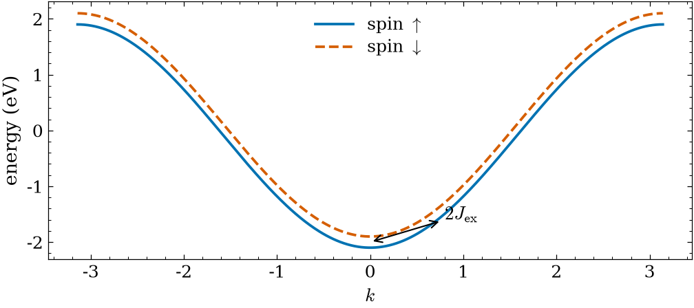
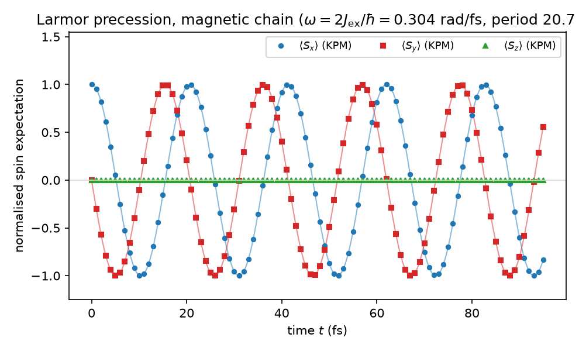

# Tutorial 4: How a spin keeps time in a magnetic chain

A compass needle in a magnetic field does not snap into alignment. It swings
around the field, precessing at a steady rate fixed by the field strength alone.
An electron spin does exactly the same, and that steady swing is a clock: as long
as the motion stays coherent, the spin keeps perfect time. The question this
tutorial answers is whether we can watch that clock run inside a tight-binding
solid, and whether its rate really depends on nothing but the field, not on which
electron happens to carry the spin.

We prepare a spin pointing along $x$, let it evolve under a chain with a Zeeman
field along $z$, and read back the three spin components in time. The lesson here
is that a clean magnetic field makes every spin precess at one Larmor frequency,
$\omega = 2J_{\rm ex}/\hbar$, the same at every energy, coherent and reversible.

## The physics

The magnetic chain is the 1D hopping chain with a constant exchange (Zeeman)
field along $z$, acting on a two-component (spin) orbital per site:

$$ H = -2\gamma\cos(ka)\,\otimes\,\mathbb{1}_{\rm spin} \;-\; J_{\rm ex}\,\sigma_z, \qquad \gamma = 1\ \mathrm{eV},\quad J_{\rm ex} = 0.1\ \mathrm{eV}. $$

The field splits spin-up from spin-down by $2J_{\rm ex}$, so the spectrum is the
chain band shifted into two exchange-split copies filling $[-2.1, 2.1]\ \mathrm{eV}$.

A spin prepared along $+x$ is an equal superposition of the two $\sigma_z$
eigenstates, which acquire a relative phase $2J_{\rm ex}\,t/\hbar$ as they evolve.
That phase rotates the spin in the $x$–$y$ plane: it precesses. The precession
frequency is the level splitting over $\hbar$ and nothing else,

$$ \langle S_x(t)\rangle = \cos\omega t, \quad \langle S_y(t)\rangle = -\sin\omega t, \quad \langle S_z(t)\rangle = 0, \qquad \omega = \frac{2J_{\rm ex}}{\hbar}, $$

independent of the Fermi energy. In LSQUANT's physical units, $\hbar = 0.6582\ \mathrm{eV\,fs}$
and time is in fs, so $\omega = 0.3039\ \mathrm{rad/fs}$ and the period is
$2\pi/\omega = 20.68\ \mathrm{fs}$. LSQUANT obtains this by evaluating the
projected time-evolution words `Tr[P:PX U(t)^+ S_a U(t) delta(E-H) P:PX]` with a
Bessel–Chebyshev expansion of $U(t) = e^{-iHt/\hbar}$, never diagonalizing $H$.



## Step 1: evolve the spin

[`run_spin.json`](run_spin.json) evaluates the three projected time-evolution words
`Tr[P:PX U(t)^+ SX U(t) delta(E-H) P:PX]`, `Tr[P:PX U(t)^+ SY U(t) delta(E-H) P:PX]`,
and `Tr[P:PX U(t)^+ SZ U(t) delta(E-H) P:PX]` on `chain1d_mag` ($N = 128$ spin
orbitals, $M = 32$ Chebyshev moments, $96$ time steps up to $t_{\max} = 95\ \mathrm{fs}$,
exact trace):

```bash
python3 -m lsquant run examples/04_spin_precession_magnetic_chain/run_spin.json --out /tmp/tut04
```

To stage the operators (`operators/chain1d_mag.{HAM,SX,SY,SZ,PX}.CSR`) into the
local directory directly:

```bash
python3 examples/04_spin_precession_magnetic_chain/make_chain_mag.py
```

Because the Larmor frequency is energy-independent, the energy-integrated spin is
just the $m = 0$ Chebyshev moment of each `.chebmomTD` file.

## Step 2: the spin keeps Larmor time

Generate both tutorial figures from the run output directory:

```bash
python3 examples/04_spin_precession_magnetic_chain/plot.py /tmp/tut04
```



The $\langle S_x\rangle$ points follow $\cos\omega t$ and $\langle S_y\rangle$
follow $-\sin\omega t$: the spin sweeps a full circle in the $x$–$y$ plane every
$20.7\ \mathrm{fs}$, while $\langle S_z\rangle$ stays pinned at zero, because the
field is along $z$ and cannot torque the $z$-component. The KPM points sit on the
analytic curves to machine precision ($< 4 \times 10^{-15}$).

## Output files and figures

| File | Description |
|---|---|
| `TimeProjSX-PXchain1d_magKPM_M32_stateexact.chebmomTD` | Time-dependent Chebyshev moments ($M = 32$, $N_t = 96$) for $S_x(t)$ |
| `TimeProjSY-PXchain1d_magKPM_M32_stateexact.chebmomTD` | Time-dependent Chebyshev moments ($M = 32$, $N_t = 96$) for $S_y(t)$ |
| `TimeProjSZ-PXchain1d_magKPM_M32_stateexact.chebmomTD` | Time-dependent Chebyshev moments ($M = 32$, $N_t = 96$) for $S_z(t)$ |
| `run.resolved.json` | Resolved run configuration and file manifest |
| `fig_zeeman.png` | Exchange-split 1D bands $E_{\uparrow,\downarrow}(k) = -2\gamma\cos(ka) \mp J_{\rm ex}$ |
| `fig_precession.png` | Normalised spin expectations $\langle S_\alpha(t)\rangle / \langle S_x(0)\rangle$ vs. analytic Larmor curves |

## What to take away

- A Zeeman field makes a transverse spin precess at the Larmor frequency
  $\omega = 2J_{\rm ex}/\hbar$, fixed by the field alone.
- In a clean system the precession is coherent and reversible: the amplitude never
  decays, so the spin keeps perfect time.
- The frequency is energy-independent, so the $m=0$ Chebyshev moment already
  carries the full precession without energy reconstruction.
- LSQUANT evolves the spin operator through a Bessel–Chebyshev expansion of
  $e^{-iHt/\hbar}$, so the clock runs without diagonalizing $H$.

## References

- Z. Fan, J. H. García, A. W. Cummings et al., *Linear scaling quantum transport
  methodologies*, Phys. Rep. **893**, 1–123 (2021) ([arXiv:1811.07387](https://arxiv.org/abs/1811.07387)).
- A. W. Cummings, J. H. García, J. Fabian, and S. Roche, *Giant spin lifetime
  anisotropy in graphene*, Phys. Rev. Lett. **119**, 206601 (2017).
