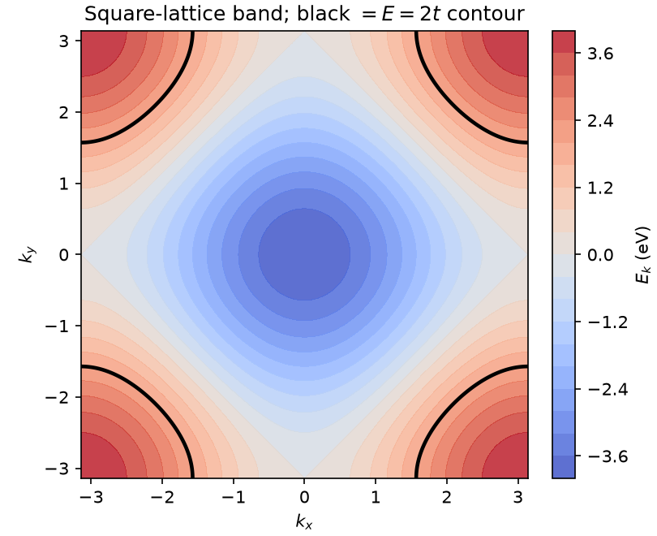
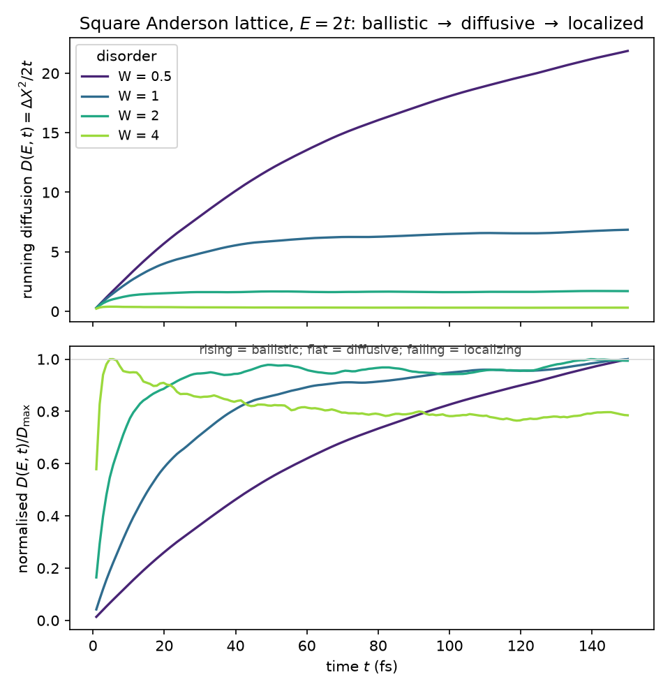
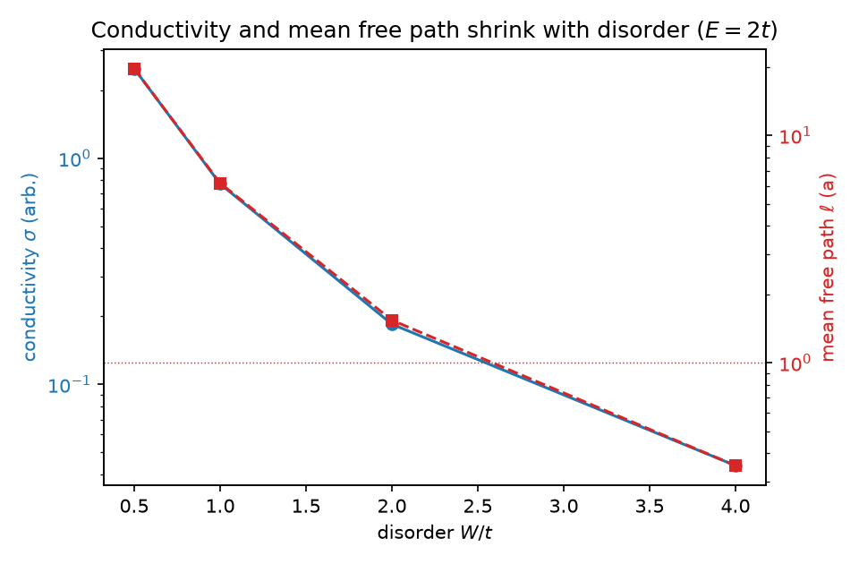

> Pedagogical tutorial — illustrative, not a regression golden.

# Tutorial 5: What sets the resistance of a disordered metal

A perfect crystal is a perfect conductor: an electron in a Bloch state flies
through it forever, and the resistance is zero. Every real metal has finite
resistance, and the reason is disorder. Impurities and defects scatter the
electron, breaking its ballistic flight into a random walk. The deep question is
how that random walk sets a number you can measure, the conductivity, and what
happens when the disorder grows so strong that the walk itself grinds to a halt.

We answer it on the 2D square lattice with onsite (Anderson) disorder by tracking
one thing: how far an electron spreads in time. The lesson here is that the
conductivity and the mean free path are read straight off that spreading, through
the Einstein relation, and that turning up disorder walks the system through three
regimes in order, ballistic, then diffusive, then localized.

## The physics

The model is the square lattice, one orbital per site, hopping $t$ (we set
$t = 1$ and lattice constant $a = 1$), with an independent random onsite energy on
each site:

$$ H = -t\sum_{\langle ij\rangle}\big(|i\rangle\langle j| + |j\rangle\langle i|\big) + \sum_i \epsilon_i\,|i\rangle\langle i|, \qquad \epsilon_i \ \text{uniform in}\ [-W/2,\,W/2]. $$

The clean band is $E_{\mathbf k} = -2t(\cos k_x + \cos k_y)$, filling $[-4t, 4t]$.
We work at a fixed energy $E = 2t$, away from the logarithmic van Hove singularity
at $E=0$ and from the band edges.

The quantity that carries everything is the mean-square displacement
$\Delta X^2(E,t)$, the spread of a wavepacket at energy $E$ after a time $t$. Its
time dependence names the regime, and its slope is the diffusion coefficient:

$$ \Delta X^2 \sim t^2 \ (\text{ballistic}), \qquad \Delta X^2 \sim t \ (\text{diffusive}), \qquad D(E,t) = \frac{\Delta X^2(E,t)}{2t}. $$

In the diffusive regime $D(E,t)$ settles on a plateau $D_{\max}(E)$, the
semiclassical diffusion coefficient. Two physical numbers follow at once. The
conductivity is the Einstein relation,

$$ \sigma(E) = e^2\,\rho(E)\,D_{\max}(E), $$

with $\rho(E)$ the density of states per site (`Tr[delta(E-H)]`). The mean free
path is $\ell = v_F\,\tau$; with $\Delta X^2$ the $x$-projection in 2D the
convention is $D_x = \tfrac12 v_F^2\tau$, so

$$ \ell = \frac{2\,D_{\max}}{v_F}, \qquad v_F = \big\langle\,|\nabla_{\mathbf k}E_{\mathbf k}|\,\big\rangle_{E\text{-contour}}. $$



## Step 1: evaluate the MSD and DOS across disorder strengths

[`run_transport.json`](run_transport.json) calls [`make_square.py`](make_square.py)
for a $200 \times 200$ lattice ($N = 40{,}000$) across $W = 0.5, 1.0, 2.0, 4.0$,
evaluates both the mean-square displacement word
`Tr[[X, U(t)]^+ delta(E-H) [X, U(t)]]` ($M = 256$, $160$ time steps up to
$t_{\max} = 150\ \mathrm{fs}$) and the density-of-states word `Tr[delta(E-H)]`
($M = 1024$), and reconstructs $\Delta X^2(E=2, t)$ and $\rho(E)$ at
$\eta = 80\ \mathrm{meV}$:

```bash
python3 -m lsquant run examples/05_charge_transport_square/run_transport.json --out /tmp/tut05
```

To build a single disordered square lattice on disk directly:

```bash
python3 examples/05_charge_transport_square/make_square.py 200 1.0 1
```

## Step 2: disorder drives ballistic to diffusive to localized

Generate all three tutorial figures from the run output directory:

```bash
python3 examples/05_charge_transport_square/plot.py /tmp/tut05
```



In `fig_diffusion.png`, panel (a) shows $D(E,t) = \Delta X^2 / (2t)$ directly, and
panel (b) normalises each curve to its own maximum $D_{\max}$: $W = 0.5$ keeps
rising across the window (ballistic), $W = 1$ and $W = 2$ settle onto a diffusive
plateau, and $W = 4$ peaks and decays back toward $0.8\,D_{\max}$ (the onset of
2D weak localization).



`fig_transport.png` shows the Einstein conductivity $\sigma = e^2 \rho D_{\max}$
and mean free path $\ell = 2 D_{\max} / v_F$ falling by nearly two decades from
$W = 0.5$ ($\ell \approx 20\,a$) to $W = 4.0$ ($\ell \approx 0.35\,a$, below the
Ioffe–Regel limit $\ell \sim a$).

## Output files and figures

| File | Description |
|---|---|
| `meanMSD-VXsquare_L200_W{0.5,1,2,4}*EF2.000000JACKSON.dat` | Reconstructed $\Delta X^2(E=2, t)$ for each disorder strength $W$ |
| `meanSpectralOp1square_L200_W{0.5,1,2,4}*JACKSON.dat` | Reconstructed extensive DOS $N\rho(E)$ for each disorder strength $W$ |
| `run.resolved.json` | Resolved run configuration and file manifest |
| `fig_fermi.png` | Clean 2D square-lattice band structure and $E = 2t$ Fermi contour |
| `fig_diffusion.png` | Running diffusivity $D(E,t)$ (panel a) and normalised $D(E,t)/D_{\max}$ (panel b) |
| `fig_transport.png` | Einstein conductivity $\sigma(W)$ and mean free path $\ell(W)$ across disorder |

## What to take away

- The mean-square displacement names the transport regime: $\Delta X^2\sim t^2$ is
  ballistic, $\sim t$ is diffusive, and a falling $D(E,t)$ is localizing.
- The conductivity follows from the diffusion by the Einstein relation
  $\sigma = e^2\rho D_{\max}$, with the KPM density of states supplying $\rho$.
- The mean free path $\ell = 2D_{\max}/v_F$ shrinks monotonically with disorder,
  from many lattice spacings down through the Ioffe–Regel limit $\ell\sim a$.

## References

- A. Weiße, G. Wellein, A. Alvermann, and H. Fehske, *The kernel polynomial method*,
  Rev. Mod. Phys. **78**, 275 (2006).
- Z. Fan, J. H. García, A. W. Cummings et al., *Linear scaling quantum transport
  methodologies*, Phys. Rep. **893**, 1–123 (2021) ([arXiv:1811.07387](https://arxiv.org/abs/1811.07387)).
