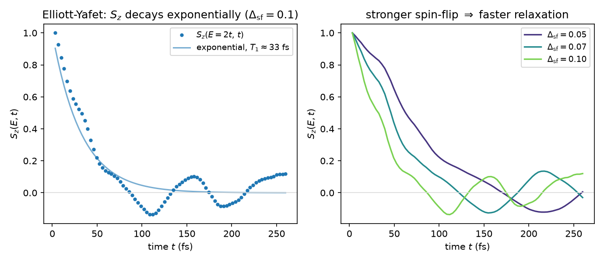
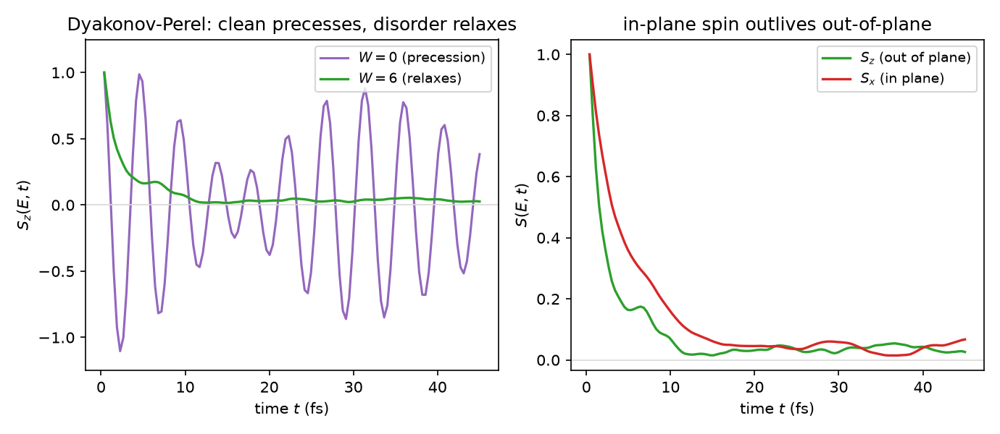
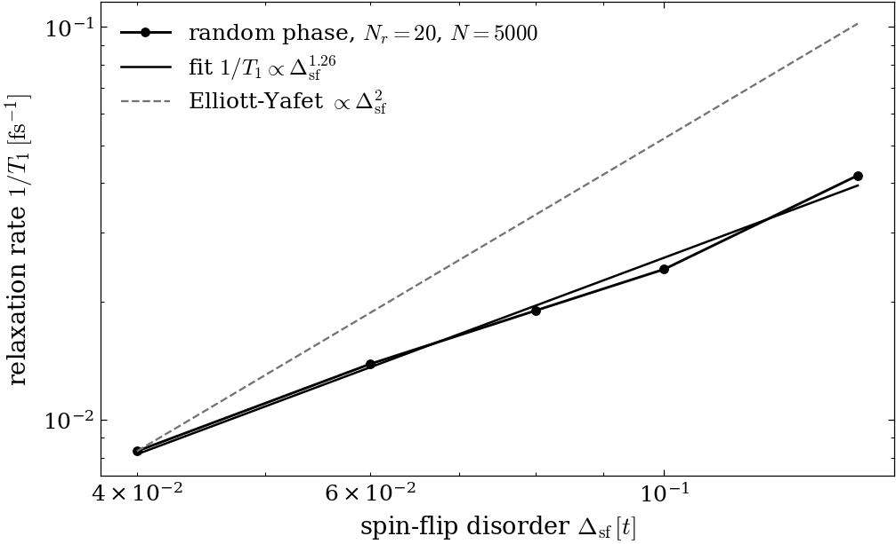

> Pedagogical tutorial — illustrative, not a regression golden.

# Tutorial 6: The two ways disorder erases a spin

Tutorial 4 showed a spin precessing forever in a clean magnetic field, a perfect
clock that never forgets which way it pointed. Real materials forget. Inject a
spin-polarized current into a metal and its polarization fades over a spin
lifetime $\tau_s$, the central number of spintronics. Two distinct mechanisms
erase the spin, and they respond to momentum scattering in opposite directions:
**Elliott–Yafet** relaxes the spin faster when scattering increases, whereas
**Dyakonov–Perel** relaxes it slower.

## The physics

In the **Elliott–Yafet** mechanism the spin flips during a momentum-scattering
event: each collision carries a small amplitude to exchange up and down. With a
random onsite spin-flip field of variance $\Delta_{\rm sf}^2$ the Fermi golden rule
gives a rate set by the spin-flip strength and the density of states,

$$ \frac{1}{T_1} = \frac{4\pi}{\hbar}\,\Delta_{\rm sf}^2\,\rho(E), \qquad \tau_s \ \text{shrinks as scattering grows.} $$

In the **Dyakonov–Perel** mechanism the spin instead precesses between collisions
around a momentum-dependent spin-orbit field $\boldsymbol\Omega(\mathbf k)$ (here a
uniform Rashba coupling). Each collision throws the spin onto a new $\mathbf k$
with a new precession axis, so the spin random-walks on the Bloch sphere. In the
motional-narrowing regime $\Omega_F\tau_p\ll1$ the rate is

$$ \frac{1}{T_z} = \Omega_F^2\,\tau_p, \qquad \tau_s \ \text{grows as scattering grows.} $$

The Rashba field lies in the plane, so it relaxes the out-of-plane spin faster than
the in-plane one ($T_\parallel/T_z = 2$).

LSQUANT measures both by evaluating the projected spin time-evolution words
`Tr[P:PZ U(t)^+ SZ U(t) delta(E-H) P:PZ]` and `Tr[P:PX U(t)^+ SX U(t) delta(E-H) P:PX]`
normalised by the conserved energy-projected state norm
`Tr[P:P_a U(t)^+ 1 U(t) delta(E-H) P:P_a]` at $E = 2t$.

## Step 1: evaluate the Elliott–Yafet and Dyakonov–Perel words

[`run_relaxation.json`](run_relaxation.json) calls [`make_ey.py`](make_ey.py) and
[`make_rashba.py`](make_rashba.py), evaluates the projected spin evolution words for
Part A (Elliott–Yafet, $L = 20$, $\Delta_{\rm sf} = 0.05, 0.07, 0.10$), Part B
(Dyakonov–Perel Rashba, $L = 20$, $\lambda = 0.2$, $W = 0, 6$, out-of-plane $S_z$
and in-plane $S_x$), and the random-phase rate-law sweep ($L = 50$, $N = 5000$,
$N_r = 20$ random-phase vectors across $\Delta_{\rm sf} \in [0.04, 0.14]$):

```bash
python3 -m lsquant run examples/06_spin_relaxation_square/run_relaxation.json --out /tmp/tut06
```

To build a single Elliott–Yafet or Rashba model on disk directly:

```bash
python3 examples/06_spin_relaxation_square/make_ey.py 20 0.1 1
python3 examples/06_spin_relaxation_square/make_rashba.py 20 0.2 6 1
```

## Step 2: generate the relaxation and rate-law figures

```bash
python3 examples/06_spin_relaxation_square/plot.py /tmp/tut06
```



In `fig_ey.png`, panel (a) shows $S_z(E=2t, t)$ decaying exponentially as
$e^{-t/T_1}$, and panel (b) overlays $\Delta_{\rm sf} = 0.05, 0.07, 0.10$, showing
faster relaxation with stronger spin-flip scattering.



In `fig_dp.png`, panel (a) contrasts coherent precession around the clean Rashba
field ($W = 0$) with Dyakonov–Perel relaxation under scalar disorder ($W = 6$).
Panel (b) contrasts out-of-plane $S_z$ with in-plane $S_x$ at $W = 6$, showing that
the in-plane spin outlives the out-of-plane spin.



`fig_ey_ratelaw.png` plots the random-phase ($N_r = 20$, $L = 50$) relaxation rate
$1/T_1$ against $\Delta_{\rm sf}$ alongside the Fermi golden-rule $\Delta_{\rm sf}^2$
slope.

## Output files and figures

| File | Description |
|---|---|
| `meanTimeProj{SZ,1}-PZey_L20_D{0.05,0.07,0.1}*EF2.000000JACKSON.dat` | Elliott–Yafet numerator and denominator curves at $E = 2t$ |
| `meanTimeProj{SZ,1}-PZrashba_L20_l0.2_W{0,6}*EF2.000000JACKSON.dat` | Dyakonov–Perel out-of-plane $S_z$ numerator and denominator curves |
| `meanTimeProj{SX,1}-PXrashba_L20_l0.2_W6*EF2.000000JACKSON.dat` | Dyakonov–Perel in-plane $S_x$ numerator and denominator curves |
| `ey_ratelaw.dat` | Random-phase Elliott–Yafet relaxation rate $1/T_1$ vs. $\Delta_{\rm sf}$ ($L = 50$, $N_r = 20$) |
| `run.resolved.json` | Resolved run configuration and file manifest |
| `fig_ey.png` | Elliott–Yafet exponential spin decay (panel a) and $\Delta_{\rm sf}$ sweep (panel b) |
| `fig_dp.png` | Dyakonov–Perel clean precession vs. disordered relaxation (panel a) and spin anisotropy (panel b) |
| `fig_ey_ratelaw.png` | Log–log Elliott–Yafet rate law $1/T_1(\Delta_{\rm sf})$ from the stochastic trace |

## What to take away

- Spin relaxation comes in two mechanisms: Elliott–Yafet (spin-flip at each
  collision) and Dyakonov–Perel (precession between collisions, randomized by
  scattering).
- Energy-resolved projected real-time evolution `Tr[P U(t)^+ S_a U(t) delta(E-H) P]`
  captures both coherent spin precession and irreversible spin relaxation.
- Replacing the exact $O(N)$ trace with $N_r \ll N$ random-phase vectors scales the
  same calculation to large disordered lattices.

## References

- Z. Fan, J. H. García, A. W. Cummings et al., *Linear scaling quantum transport
  methodologies*, Phys. Rep. **893**, 1–123 (2021) ([arXiv:1811.07387](https://arxiv.org/abs/1811.07387)).
- A. W. Cummings, J. H. García, J. Fabian, and S. Roche, *Giant spin lifetime
  anisotropy in graphene*, Phys. Rev. Lett. **119**, 206601 (2017).
